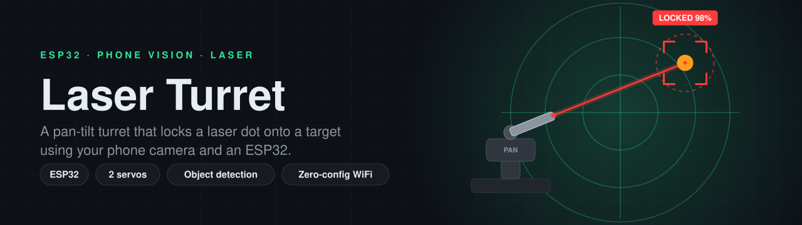
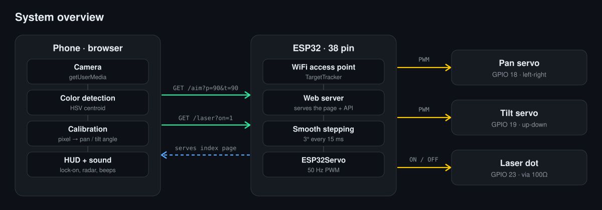
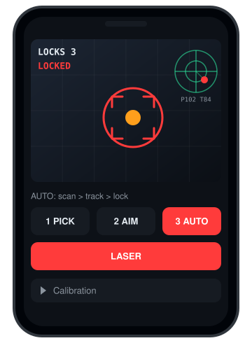
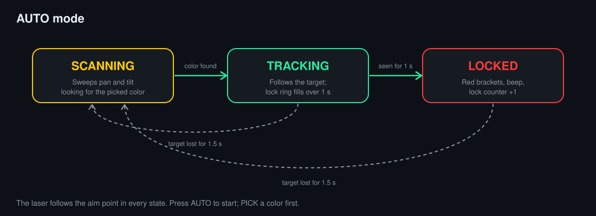
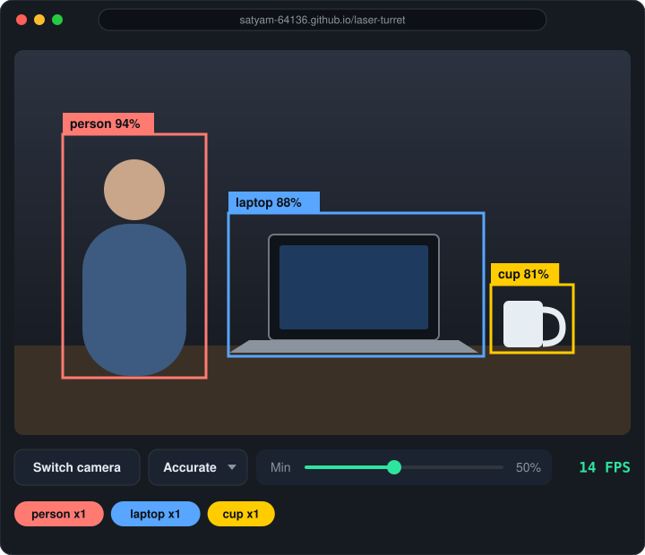
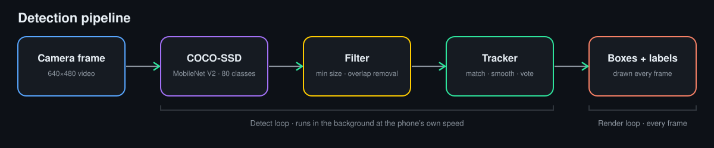
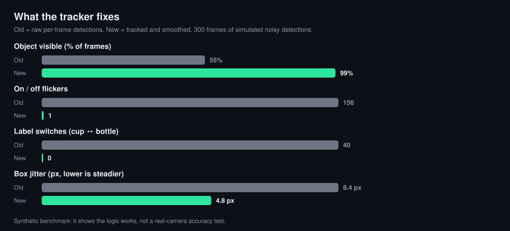

<p align="center">
  
</p>

<p align="center">
  <a href="https://satyam-64136.github.io/laser-turret/"></a>
  
  
  
  
</p>

<p align="center">
  <a href="#system-overview">System overview</a> &middot;
  <a href="#hardware">Hardware</a> &middot;
  <a href="#wiring">Wiring</a> &middot;
  <a href="#setup">Setup</a> &middot;
  <a href="#auto-mode">Auto mode</a> &middot;
  <a href="#live-object-detector">Object detector</a> &middot;
  <a href="#repository-layout">Repository layout</a> &middot;
  <a href="#roadmap">Roadmap</a>
</p>

## Overview

Laser Turret is an ESP32 pan-tilt turret that points a laser dot at a colored target. The phone camera does the vision work, and the ESP32 only moves the servos, so the whole build needs no extra camera module. The repository also includes a standalone live object detector that draws stable, labeled boxes around 80 common objects.

**Key features**

| Feature | Details |
|---|---|
| Phone-camera tracking | Color detection runs in the phone browser; the ESP32 receives only pan and tilt angles. |
| AUTO mode | Scans, tracks, and locks onto the target with no manual input. |
| Live HUD | Lock-on brackets, radar view of the aim point, lock counter, and sound cues. |
| Zero-config WiFi | The ESP32 creates its own network, so there are no credentials to edit in the code. |
| Smooth motion | Servo moves are stepped in small increments to protect the power supply. |
| Object detector | COCO-SSD with a tracking layer that removes flicker and label switching. |

## System overview

<p align="center">
  
</p>

The ESP32 serves the control page itself. The phone sends two requests, `/aim?p=<pan>&t=<tilt>` and `/laser?on=<0|1>`, and the ESP32 steps the servos toward the requested angles.

## Hardware

| Part | Qty | Notes |
|---|---|---|
| ESP32 (38 pin) | 1 | Powered from its own USB cable |
| Micro servo (SG90 or similar) | 2 | Pan and tilt |
| Laser dot emitter | 1 | Under 5 mW |
| 100 ohm resistor | 1 | In series with the laser |
| 5V power source | 1 | Power bank or USB charger, for the servos |
| Jumper wires | - | |

## Wiring

<p align="center">
  
</p>

| From | To |
|---|---|
| ESP32 GPIO 18 | Pan servo signal (orange) |
| ESP32 GPIO 19 | Tilt servo signal (orange) |
| ESP32 GPIO 23 | 100 ohm resistor, then laser red (+) |
| Laser black (-) | GND |
| Both servo red wires | +5V |
| Both servo brown wires | GND |
| ESP32 GND | Same GND as the 5V supply |

All grounds must be shared. The 5V supply powers only the servos.

## Setup

1. Install the **ESP32Servo** library in the Arduino IDE.
2. Open `firmware/target_tracker_v3/target_tracker_v3.ino`, select **ESP32 Dev Module**, and upload.
3. On the phone, join the WiFi network `TargetTracker` (password `12345678`).
4. In Chrome on the phone, open `chrome://flags`, search for **Insecure origins treated as secure**, add `http://192.168.4.1`, enable it, and relaunch. This is a one-time step that allows camera access on a plain http page.
5. Open `http://192.168.4.1` and allow the camera.

## Usage

<p align="center">
  
</p>

1. **PICK:** tap the target to lock onto its color. Use a bright, saturated object.
2. **AIM:** tap anywhere to aim, and adjust the Calibration sliders until the laser lands on the tapped point.
3. **AUTO:** the turret scans, tracks, and locks on.

Mount the phone on a fixed stand and place the laser next to the camera.

## Auto mode

<p align="center">
  
</p>

## Live object detector

<p align="center">
  
</p>

The detector is a single page, `index.html`, built on TensorFlow.js and COCO-SSD. It is served with GitHub Pages because camera access requires https:

**https://satyam-64136.github.io/laser-turret/**

It needs internet on the first load to download the model, and it offers an Accurate and a Fast model option.

### Pipeline

<p align="center">
  
</p>

Raw detections from a small model flicker, drift, and change labels from frame to frame. A tracking layer matches boxes across frames, smooths them, votes on each object's label, and keeps boxes visible through brief dropouts.

### Tracker results

<p align="center">
  
</p>

## Repository layout

```
laser-turret/
|-- README.md
|-- LICENSE
|-- .gitignore
|-- index.html                                  Object detector (GitHub Pages)
|-- firmware/
|   `-- target_tracker_v3/
|       `-- target_tracker_v3.ino               ESP32 firmware and control page
`-- docs/
    |-- banner.svg                              README header
    |-- social-preview.svg / .png               GitHub social preview (1280x640)
    |-- architecture.svg                        System overview
    |-- wiring.svg                              Wiring diagram
    |-- hud-preview.svg                         Control page illustration
    |-- auto-mode.svg                           AUTO mode state diagram
    |-- detector-preview.svg                    Object detector illustration
    |-- pipeline.svg                            Detection pipeline
    `-- tracker-results.svg                     Tracker comparison chart
```

| Path | Purpose |
|---|---|
| `firmware/target_tracker_v3/target_tracker_v3.ino` | Flash this to the ESP32. It hosts the control page and drives the servos and laser. |
| `index.html` | Standalone object detector. Open it through GitHub Pages. |
| `docs/` | All diagrams and images used in this README. |
| `docs/social-preview.png` | Upload under Settings, General, Social preview. |

## Roadmap

- ESP32 joins the phone hotspot so the detector and the turret run together.
- Tap a detected box to aim the laser at it.

## Safety

Use a laser under 5 mW. Never point it at eyes, mirrors, or glass.

## License

MIT. See [LICENSE](LICENSE).
