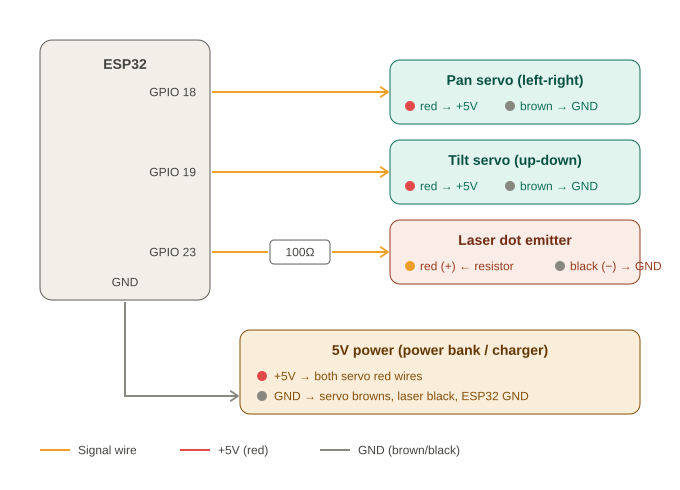

# Laser Turret

An ESP32 pan-tilt turret that points a laser dot at a colored target, controlled from your phone camera. Includes a live object detector page that draws labeled boxes around 80 common objects.

## Features

- **Phone-camera tracking:** the phone does the vision, the ESP32 only moves the servos.
- **AUTO mode:** scans left and right, tracks the target, then locks on after 1 second.
- **Live HUD:** lock-on brackets, a radar of the aim point, lock counter, and sound cues.
- **Zero-config WiFi:** the ESP32 creates its own network, so there are no passwords to edit.
- **Live object detector:** stable, smoothed boxes with labels for people, bottles, cups, phones, laptops and more.

## Hardware

| Part | Qty |
|---|---|
| ESP32 (38 pin) | 1 |
| Micro servo (SG90 or similar) | 2 |
| Laser dot emitter (under 5mW) | 1 |
| 100Ω resistor | 1 |
| 5V power source (power bank or USB charger) | 1 |
| Jumper wires | - |

## Wiring

| From | To |
|---|---|
| ESP32 GPIO 18 | Pan servo signal (orange) |
| ESP32 GPIO 19 | Tilt servo signal (orange) |
| ESP32 GPIO 23 | 100Ω resistor, then laser red (+) |
| Laser black (-) | GND |
| Both servo red wires | +5V |
| Both servo brown wires | GND |
| ESP32 GND | Same GND as the 5V supply |

Power the ESP32 from its own USB cable. The 5V supply runs only the servos.

## Setup

1. Install the **ESP32Servo** library in the Arduino IDE.
2. Open `firmware/target_tracker_v3/target_tracker_v3.ino`, select **ESP32 Dev Module**, and upload.
3. On your phone, join the WiFi network `TargetTracker` (password `12345678`).
4. In Chrome on the phone, open `chrome://flags`, search for **Insecure origins treated as secure**, add `http://192.168.4.1`, enable it, and relaunch. This is a one-time step that allows camera access.
5. Open `http://192.168.4.1` and allow the camera.

## Usage

1. **PICK:** tap the target to lock its color. Use a bright, colorful object.
2. **AIM:** tap anywhere to aim, and adjust the Calibration sliders until the laser lands where you tapped.
3. **AUTO:** the turret scans, tracks, and locks on.

Keep the phone on a fixed stand and mount the laser next to the camera.

## Live object detector

`index.html` is a standalone page using TensorFlow.js and COCO-SSD. Camera access needs https, so it is served with GitHub Pages:

**https://satyam-64136.github.io/laser-turret/**

It needs internet on first load to download the model.

## Roadmap

- ESP32 joins the phone hotspot so the detector and turret run together.
- Tap a detected box to aim the laser at it.

## Safety

Use a laser under 5mW. Never point it at eyes, mirrors, or glass.

## License

MIT, see [LICENSE](LICENSE).
